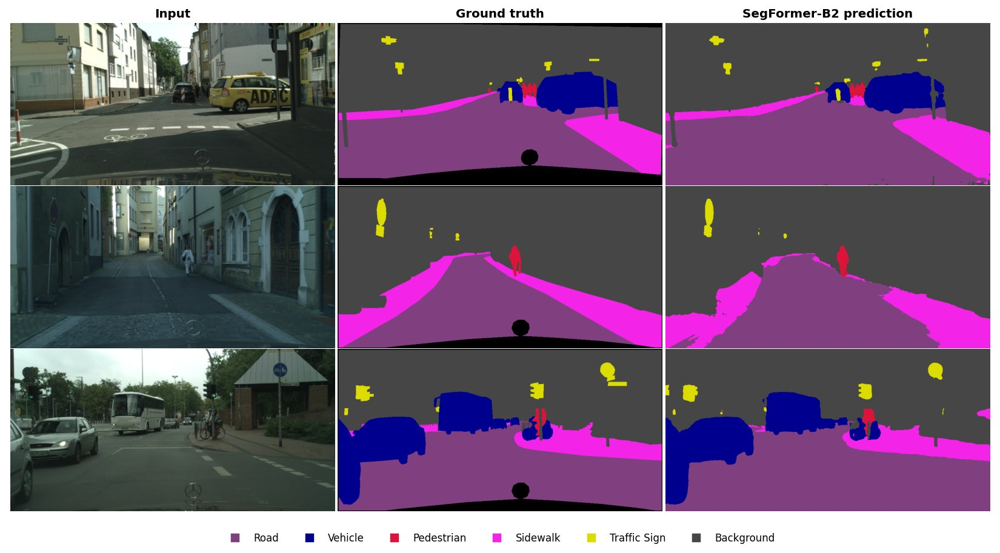
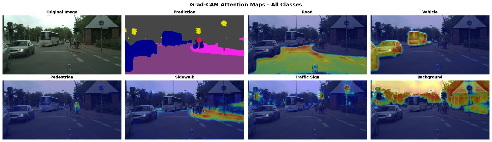

# Semantic Segmentation for Autonomous Driving

[](https://www.python.org/)
[](https://pytorch.org/)
[](LICENSE)

A PyTorch semantic segmentation pipeline for road scenes. It classifies every pixel into 6 classes and covers the full workflow: data preparation, four model architectures, training, evaluation, inference, Grad-CAM explainability, ONNX export, and a Streamlit dashboard.

**Best result:** SegFormer-B2 reaches **0.833 mIoU** on 500 held-out Cityscapes images, scored at full 1024×2048 resolution, and runs at about 28 FPS on a laptop RTX 5050. See [Results](#results).


<sub>Held-out Cityscapes test images (input · ground truth · prediction). Black areas in the ground truth are ignored pixels. Images © Cityscapes.</sub>

---

## Table of Contents

- [Classes](#classes)
- [Architecture](#architecture)
- [Installation](#installation)
- [Dataset Setup](#dataset-setup)
- [Quick Start](#quick-start)
- [Training](#training)
- [Evaluation](#evaluation)
- [Inference](#inference)
- [Explainability](#explainability)
- [Model Export](#model-export)
- [Results](#results)
- [Interactive Dashboard](#interactive-dashboard)
- [Tests](#tests)
- [Project Structure](#project-structure)
- [Changelog: pipeline fixes](#changelog-pipeline-fixes)
- [Future Improvements](#future-improvements)

---

## Classes

| # | Class | Color | Cityscapes labels |
|---|-------|-------|-------------------|
| 0 | Road | Purple | road (lane markings are part of road) |
| 1 | Vehicle | Dark Blue | car, truck, bus, caravan, trailer, train, motorcycle, bicycle |
| 2 | Pedestrian | Crimson | person, rider |
| 3 | Sidewalk | Pink | sidewalk |
| 4 | Traffic Sign | Yellow | traffic sign, traffic light |
| 5 | Background | Dark Gray | everything else (building, vegetation, sky, pole, ...) |
| — | *ignored (255)* | — | unlabeled, ego vehicle, rectification border, out of ROI |

Ignored pixels are excluded from the loss and from every metric. The mapping lives in one place, `config.py → CITYSCAPES_LABEL_MAP`. It is applied once, by `prepare_dataset.py`.

> There is no lane-marking class: Cityscapes has no lane-marking annotations, so such a class can't be learned from it.

---

## Architecture

All models map `(B, 3, H, W)` images to `(B, 6, H, W)` class logits.

| Model | Encoder | Pretrained | Params |
|-------|---------|------------|--------|
| **U-Net** | 4-stage conv encoder (64→512) + 1024 bottleneck | — (from scratch) | 31.0 M |
| **ResNet50-UNet** | ResNet50 + U-Net decoder with skip connections | ImageNet | 40.9 M |
| **DeepLabV3+** | Dilated ResNet50 (OS 16) + ASPP (6/12/18) + low-level fusion | ImageNet | 40.3 M |
| **SegFormer-B2** | Mix Transformer (hierarchical, efficient attention) + all-MLP decoder | ImageNet (MiT-B2 via 🤗 `transformers`) | 27.4 M |

`model.py` also contains a from-scratch SegFormer implementation. It is used only when `transformers` isn't installed. Transformers trained from scratch need far more data than Cityscapes has, so prefer the pretrained one.

**Loss:** `Combined = CrossEntropy + Dice + Focal(γ=2)`. Cross-entropy gives a stable per-pixel signal, Dice weights every class equally regardless of pixel count, and Focal emphasises hard pixels.

---

## Installation

```bash
git clone https://github.com/Vaibhav8075/Semantic-Segmentation-for-Autonomous-Driving-.git
cd Semantic-Segmentation-for-Autonomous-Driving-

python -m venv venv
venv\Scripts\activate            # Windows
source venv/bin/activate         # Linux/Mac

# 1. PyTorch + torchvision with CUDA: pick the command for your CUDA version at https://pytorch.org/
pip install torch torchvision --index-url https://download.pytorch.org/whl/cu128

# 2. Everything else
pip install -r requirements.txt
```

`torchvision` (and `torchaudio`, if installed) must match your `torch` version. A mismatched `torchaudio` makes `import transformers` fail.

```bash
python -c "import torch, torchvision; print(torch.__version__, torchvision.__version__, torch.cuda.is_available())"
```

---

## Dataset Setup

### Option A: Cityscapes (real data)

**Official source:** register at [cityscapes-dataset.com](https://www.cityscapes-dataset.com/register/) and download `leftImg8bit_trainvaltest.zip` (~11 GB) and `gtFine_trainvaltest.zip` (~241 MB).

**Or via Kaggle:** [`lqdisme/cityscapes`](https://www.kaggle.com/datasets/lqdisme/cityscapes) is the same official package in one 11.85 GB download.

```bash
pip install kaggle   # put your API token in ~/.kaggle/kaggle.json (Kaggle → Settings → API)
kaggle datasets download -d lqdisme/cityscapes -p C:/datasets/cityscapes
# If the download stops, run the same command again; it resumes.
```

Unzip it (only `leftImg8bit/{train,val}` and the `*_gtFine_labelIds.png` masks are needed), then prepare:

```bash
python prepare_dataset.py --cityscapes-root C:/datasets/cityscapes --output-root C:/datasets/cityscapes_prepared
python train.py --model deeplabv3plus --dataset-root C:/datasets/cityscapes_prepared --run-name deeplabv3plus_cityscapes
```

`prepare_dataset.py` finds the `leftImg8bit/` and `gtFine/` folders even when they're nested, as in the Kaggle copy.

> Keep the dataset **outside** cloud-synced folders such as OneDrive. Otherwise ~20 GB of images will start uploading.

Cityscapes is licensed for non-commercial research; credit it and don't re-upload the data.

The official Cityscapes **test** split has no public labels, so the splits are:

| Our split | Source | Images |
|-----------|--------|--------|
| train | official train, minus 4 held-out cities | 2,554 |
| val | official train: darmstadt, krefeld, ulm, weimar (`--val-cities`) | 421 |
| test | official val | 500 |

### Option B: Synthetic road scenes (no download)

```bash
python prepare_dataset.py --mock --output-root ./dataset --num-samples 500
```

This renders 500 scenes at 512×1024 (300/100/100), including sky, buildings, trees, a textured road with painted lane lines, sidewalks, cars, pedestrians and signs on poles. Images are *rendered*, not painted in label colours, so the model has to learn shape and context. It's useful for development, but it is much easier than real data (see [Results](#results)).

Both options write `dataset/dataset_stats.json`, which records the class list. The data loader refuses to read a dataset prepared for a different class scheme.

```
dataset/
├── images/{train,val,test}/<name>.png
├── masks/{train,val,test}/<name>.png      # class indices 0-5, 255 = ignore
└── dataset_stats.json
```

---

## Quick Start

```bash
python prepare_dataset.py --mock --output-root ./dataset     # 1. data
python eda.py --dataset-root ./dataset                        # 2. EDA plots → outputs/eda/
python train.py --model unet --epochs 30                      # 3. train → checkpoints/unet_best.pth
python evaluate.py --checkpoint checkpoints/unet_best.pth     # 4. test-set metrics
python predict.py --image dataset/images/test/mock_test_000000.png --checkpoint checkpoints/unet_best.pth
python -m pytest tests -q                                     # 5. tests
```

Checkpoints store their architecture, class list and input size. `evaluate.py`, `predict.py`, `explainability.py`, `export.py` and the dashboard rebuild the right model from the checkpoint, so you don't pass `--model` to them.

---

## Training

```bash
python train.py --model unet          --epochs 100
python train.py --model resnet_unet   --epochs 80
python train.py --model resnet_unet   --freeze-encoder --lr 3e-4
python train.py --model deeplabv3plus --epochs 100
python train.py --model segformer     --lr 6e-5 --epochs 100
```

How the data pipeline works:

- **One working resolution.** Every image is resized to `--image-size` (default 512×1024, Cityscapes' 1:2 aspect ratio) for training, validation and inference.
- **Training only** adds flips, random scale 0.75–1.5×, ±5° rotation and a random `--crop-size` crop (default 512×512), plus photometric jitter, blur, fog and shadow. Border pixels created by these transforms are labelled *ignore*, not road.

Other features:

- Linear LR warmup (`--warmup-epochs`) followed by cosine (default) or poly decay to `--min-lr`, or `--scheduler plateau`.
- AdamW, FP16 mixed precision, gradient clipping and early stopping on validation mIoU.
- Checkpoints are written to `checkpoints/<model>_best.pth` and `<model>_latest.pth` (rename runs with `--run-name`). Outputs go to `outputs/training/<model>/`, including curves, sample predictions, `training_summary.json` and TensorBoard logs.
- `--resume checkpoints/unet_latest.pth` restores the model, optimizer, scheduler, AMP scaler and early-stopping state.
- `--use-mock` generates synthetic scenes on the fly instead of reading `--dataset-root`.

The default batch size of 4 fits an 8 GB GPU. Raising it past what fits makes Windows spill into shared system memory, which is about 25× slower.

```bash
tensorboard --logdir outputs/training
```

---

## Evaluation

```bash
python evaluate.py --checkpoint checkpoints/unet_best.pth
python evaluate.py --checkpoint checkpoints/*_best.pth        # compare several models
```

Predictions are upsampled to the ground-truth resolution before scoring.

**Averaging rule.** mIoU, mean Dice, precision and recall average over every class that appears in the ground truth *or* in the predictions. A class that is predicted but absent from the ground truth therefore counts with IoU 0, so false positives aren't hidden.

Reports are written to `outputs/evaluation/<run>/`: confusion matrices, per-class IoU / Dice / precision / recall CSVs, `evaluation_results.json` and sample predictions. Comparing several models also writes `outputs/evaluation/model_comparison.csv`.

---

## Inference

```bash
python predict.py --image sample.jpg       --checkpoint checkpoints/unet_best.pth
python predict.py --image-dir test_images/ --checkpoint checkpoints/unet_best.pth
python predict.py --webcam                 --checkpoint checkpoints/unet_best.pth   # q = quit, s = save
```

Each image produces a colour mask, an overlay, a confidence map and a combined figure in `outputs/predictions/`.

---

## Explainability

```bash
python explainability.py --image sample.jpg --checkpoint checkpoints/unet_best.pth --target-class pedestrian
python explainability.py --image sample.jpg --checkpoint checkpoints/unet_best.pth --all-classes
```



This uses segmentation Grad-CAM. The target is the class logit summed over the pixels predicted as that class, and the layer is chosen per architecture: U-Net bottleneck, ResNet `layer4`, DeepLab ASPP, or SegFormer fusion.

---

## Model Export

```bash
python export.py --checkpoint checkpoints/unet_best.pth --validate --benchmark
python export.py --tensorrt-guide
```

This exports to ONNX (opset 18, dynamic batch) next to the checkpoint, checks the ONNX output against PyTorch, and benchmarks ONNX Runtime.

- PyTorch's `torch.export`-based exporter is tried first. Models it can't handle, such as Hugging Face SegFormer, fall back automatically to the TorchScript exporter.
- Both Cityscapes models match PyTorch on 100% of pixels.
- The benchmark uses whichever ONNX Runtime build is installed. With the default CPU build, a 512×1024 image takes about 0.4 s (DeepLabV3+) or 1.0 s (SegFormer-B2). Install `onnxruntime-gpu` for GPU numbers.

---

## Results

<!-- RESULTS:START -->
### Cityscapes

Both models were trained on 2,554 images (official train minus 4 held-out cities) and selected on the 421 held-out-city images. They were then tested **once** on the 500 official val images, which neither model saw during training or model selection. Scoring is at full **1024×2048** label resolution.

| Model | **Test mIoU** | mDice | Pixel Acc | Val mIoU (best epoch) | Train time | ms / image* |
|-------|---------------|-------|-----------|-----------------------|-----------|-------------|
| DeepLabV3+ (ResNet50) | 0.825 | 0.900 | 95.5% | 0.835 (29) | 68 min | 21 |
| **SegFormer-B2** | **0.833** | **0.906** | **95.9%** | 0.838 (37) | ~2.2 h | 35 |

Per-class test IoU:

| Model | Road | Vehicle | Pedestrian | Sidewalk | Traffic Sign | Background |
|-------|------|---------|------------|----------|--------------|------------|
| DeepLabV3+ | 0.941 | 0.909 | 0.772 | 0.730 | 0.672 | 0.927 |
| SegFormer-B2 | **0.946** | **0.910** | **0.780** | **0.752** | **0.680** | **0.932** |

\*Model forward pass at 512×1024 input, FP16, RTX 5050 Laptop GPU (8 GB): about 48 FPS for DeepLabV3+ and 28 FPS for SegFormer-B2.

Setup: 40 epochs (early stopping, patience 10), AdamW, 3-epoch warmup then cosine decay, 512×512 crops from 512×1024 images, batch 4, combined CE + Dice + Focal loss. LR is 1e-4 for DeepLabV3+ and 6e-5 for SegFormer.

**What the numbers say**

- **SegFormer-B2 is better on every class**, with fewer parameters (27 M vs 40 M), at about 1.7× the inference cost.
- **Small and thin objects are the hard part.** Traffic signs (0.68) and pedestrians (0.78) are well below road (0.95), because they cover few pixels and are often far away.
- **Sidewalk vs road** (0.75) is the main confusion between large regions. Their edges are often only a kerb.

> These 6-class scores are **not comparable** to the public Cityscapes leaderboard. The leaderboard uses 19 classes, and merging classes (e.g. all vehicles into one) makes the task easier.

### Synthetic scenes (pipeline check)

All four models trained on the 300 synthetic training scenes and evaluated on the 100 held-out test scenes (512×1024, RTX 5050 Laptop 8 GB, FP16, batch 4).

| Model | Test mIoU | Road | Vehicle | Pedestrian | Sidewalk | Traffic Sign | Background | Train time | ms / image* |
|-------|-----------|------|---------|------------|----------|--------------|------------|-----------|-------------|
| U-Net | 0.982 | 0.992 | 0.976 | 0.947 | 0.993 | 0.989 | 0.997 | 17 min (30 ep) | 65 |
| ResNet50-UNet | 0.982 | 0.999 | 0.992 | 0.957 | 0.995 | 0.951 | 1.000 | 9 min (25 ep) | 24 |
| DeepLabV3+ | 0.979 | 0.997 | 0.983 | 0.948 | 0.979 | 0.967 | 0.999 | 7 min (25 ep) | 21 |
| SegFormer-B2 | 0.983 | 0.998 | 0.986 | 0.959 | 0.983 | 0.971 | 0.999 | 12 min (25 ep) | 38 |

\*Model forward pass only, FP16, averaged over batches of 4.

These scenes are deliberately simple: flat colours, clean edges, no occlusion clutter. Near-perfect scores here show the pipeline is correct end to end. They say nothing about real-world accuracy; use the Cityscapes results for that. Even here, the smallest classes (pedestrians and signs) are the hardest.
<!-- RESULTS:END -->

---

## Interactive Dashboard

```bash
python -m streamlit run dashboard.py
```

The dashboard has three tabs:

1. **Image segmentation and explainability:** pick a test image or upload one to see the mask, overlay, confidence heatmap and Grad-CAM maps for each class present.
   Set *Test images folder* to `C:/datasets/cityscapes_prepared/images/test` to try the Cityscapes models on real scenes.
2. **Video playback:** segment an uploaded driving video frame by frame, with an FPS counter.
3. **Webcam:** a live stream from a local camera, or a browser snapshot with Grad-CAM.

The sidebar lets you choose the checkpoint (its architecture is detected automatically), the processing resolution, the overlay transparency and which classes to show.

---

## Tests

```bash
python -m pytest tests -q
```

The 16 regression tests cover:

- label conversion, and that prepared masks load unchanged
- rejecting datasets or checkpoints built for another class scheme
- mock-data realism
- train/val resolution and border handling
- metric averaging and ignore pixels
- model output shapes
- frozen-encoder BatchNorm
- checkpoint round-trips
- Grad-CAM hook cleanup

On Windows, pytest may print `Windows fatal exception: access violation` while importing `pyarrow` (via pandas). It's harmless: pyarrow handles the exception internally, and the tests still pass.

---

## Project Structure

```
road_segmentation/
├── config.py              # Classes, label mapping, configuration, training CLI
├── mock_data.py           # Synthetic road-scene renderer
├── prepare_dataset.py     # Cityscapes conversion & splits, mock dataset, statistics
├── dataset.py             # Datasets, augmentation pipelines, preprocessing
├── eda.py                 # Exploratory data analysis plots
├── model.py               # U-Net, ResNet50-UNet, DeepLabV3+, SegFormer (native + HF)
├── model_factory.py       # get_model(), load_model_from_checkpoint(), comparison
├── losses.py              # CE, Dice, Focal, Combined loss
├── metrics.py             # Confusion-matrix metrics (IoU, Dice, P/R/F1)
├── train.py               # Training pipeline
├── evaluate.py            # Test-set evaluation & model comparison
├── predict.py             # Inference (single / batch / webcam)
├── explainability.py      # Segmentation Grad-CAM
├── export.py              # ONNX export, validation, benchmark; TensorRT guide
├── dashboard.py           # Streamlit dashboard
├── utils.py               # Visualization, checkpoints, early stopping, logging
├── verify.py              # Quick smoke test
├── tests/                 # pytest regression tests
├── docs/images/           # Figures used in this README
├── notebooks/demo.ipynb   # Colab-compatible walkthrough
├── checkpoints/           # <model>_best.pth / <model>_latest.pth (git-ignored)
└── outputs/               # eda/, training/<model>/, evaluation/<model>/, predictions/, explainability/
```

---

## Changelog: pipeline fixes

Earlier versions of this project reported ~0.89 mIoU. That number was not meaningful. These are the problems that were fixed:

1. **Labels were remapped twice.** `prepare_dataset.py` converted masks to the 7-class scheme, then the dataset converted them *again* as if they were raw Cityscapes IDs. Background became "Lane Marking" and every other class became "Background", so the model was trained and scored on 2 scrambled classes.
2. **There was a Lane Marking class with no Cityscapes source** (it was mapped from "ground"). It has been removed, giving 6 classes. Unlabeled / ego-vehicle / border / out-of-ROI pixels are now ignored instead of being called background.
3. **Evaluation targeted the Cityscapes test split, which has no labels.** There are now city-based train/val splits, and the official val split is used as the test set.
4. **Training saw 512×512 crops at full resolution, while validation squashed the whole image to 512×512.** There is now one working resolution, with crops for training only.
5. **The mIoU hid false positives**: it averaged only over classes in the ground truth, while precision/recall averaged over all classes. There is now one consistent averaging rule.
6. **The mock images were the label colours plus noise**, so the model only learned a colour lookup. Scenes are now rendered.
7. **Smaller fixes:**
   - Geometric augmentation filled borders with label 0 (road).
   - The cosine schedule restarted mid-training and ignored `min_lr`.
   - Resume lost the early-stopping and AMP state.
   - Frozen encoders kept updating BatchNorm statistics.
   - Grad-CAM hooks piled up on every dashboard click.
   - The dashboard ran at 128×128 by default.
   - Uploaded videos leaked temp files.
   - Checkpoints didn't record their architecture.
   - SegFormer had no pretrained weights.
   - `export.py --tensorrt-guide` demanded a checkpoint.

---

## Future Improvements

1. Train at higher resolution (1024×2048 crops) or longer schedules; this is mostly limited by the 8 GB GPU.
2. Add a lane-marking class using a dataset that annotates it, such as Mapillary Vistas or BDD100K.
3. Add class-balanced sampling or OHEM for the rarest classes (signs, pedestrians).
4. Add test-time augmentation (flip and multi-scale).
5. Add INT8 quantization and TensorRT deployment, measured on target hardware.
6. Add temporal consistency for video (optical flow or feature propagation).
7. Add bird's-eye-view projection for planning.

---

## License

MIT, see [LICENSE](LICENSE).

## Acknowledgments

- [Cityscapes Dataset](https://www.cityscapes-dataset.com/) — Cordts et al., 2016
- [U-Net](https://arxiv.org/abs/1505.04597) — Ronneberger et al., 2015
- [DeepLabV3+](https://arxiv.org/abs/1802.02611) — Chen et al., 2018
- [SegFormer](https://arxiv.org/abs/2105.15203) — Xie et al., 2021
- [Focal Loss](https://arxiv.org/abs/1708.02002) — Lin et al., 2017
- [Grad-CAM](https://arxiv.org/abs/1610.02391) — Selvaraju et al., 2017
